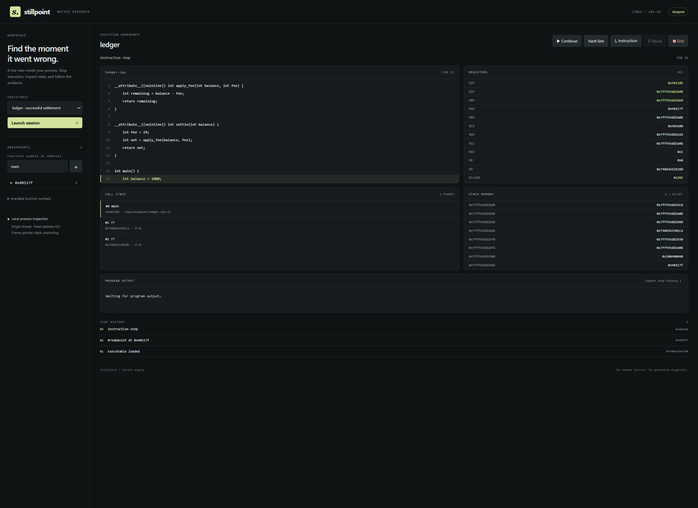

# Stillpoint

**A native crash-triage workbench for Linux C/C++ programs.** Stillpoint runs a
real executable under a small `ptrace` debugger, captures the state at a fault,
and turns it into a report that can travel with a CI failure. Use the browser
workbench to inspect a process interactively, or run the same debugger headlessly
in a pipeline.

[](https://github.com/Mudit-R/stillpoint-debugger/actions/workflows/ci.yml)



## Why Stillpoint

A failed test often leaves a signal and a log line, while the useful evidence is
spread across a debugger session: fault address, registers, stack, source, and
instructions at the program counter. Stillpoint collects those facts at the
stop and packages them as a Markdown handoff. CI can preserve the report as an
artifact while keeping the executable's conventional failure status.

The debugger engine is implemented in C++20 with Linux `ptrace`; GDB and LLDB
are not used to control the process. GNU binutils provide ELF line-table lookup,
disassembly, and address-to-source mapping.

## What it does

- Runs Linux x86-64 ELF executables and supports both fixed-address `ET_EXEC`
  and PIE `ET_DYN` binaries under ASLR.
- Sets and removes software breakpoints by function symbol, address, or mapped
  source line; restores the original instruction byte and single-steps before
  reinserting a breakpoint.
- Captures signal and kernel signal code, fault address, registers, a
  frame-pointer stack, source location, instructions at RIP, and up to 64 KiB
  of program output.
- Creates a Markdown incident report with an ELF build ID and a fingerprint
  that groups reruns of the same build while separating different builds.
- Offers a browser workbench for stepping, pausing, source breakpoints, memory
  inspection, local stop history, and JSON export.
- Optionally asks a local Ollama model for one evidence-linked hypothesis and a
  manual next check. Model output is advisory; it does not run commands or
  change debugger state.
- Provides a headless CLI for test runners and CI, including timeout handling,
  output forwarding, signal exit codes, and report generation.

## Try the workbench

### Docker

Requires Docker with Linux containers and permission to use `SYS_PTRACE`.

```sh
docker build -t stillpoint .
docker run --rm --init --name stillpoint \
  -p 127.0.0.1:8765:8765 --cap-add=SYS_PTRACE stillpoint
```

Open [http://127.0.0.1:8765](http://127.0.0.1:8765), launch `ledger`, add a
breakpoint at `main`, and continue. Try instruction stepping to watch the
registers change. Launch `crash` and continue to inspect a null-read `SIGSEGV`;
launch `loop` to try pausing a running process.

The workbench is bound to loopback and controls one shared session. It executes
native code and is not a sandbox for untrusted binaries.

### Native Linux build

Requires an x86-64 Linux system with CMake, a C++20 compiler, Python 3, and GNU
binutils.

```sh
cmake -S . -B build -DCMAKE_BUILD_TYPE=Debug
cmake --build build -j2
python3 workbench/server.py
```

The workbench is available at [http://127.0.0.1:8765](http://127.0.0.1:8765).
Targets in `build/` are discovered when the page loads. A useful configuration
for programs you compile yourself is:

```sh
g++ -g -O0 -fno-omit-frame-pointer -fPIE -pie \
  -Wl,--build-id=sha1 your.cpp -o build/your-program
```

Quoted target arguments are passed directly to the executable without a shell.
Target stdin is disconnected and reads EOF; interactive terminal input is not
supported.

## Add crash triage to CI

Run a test executable directly under Stillpoint. On a crash, the command writes
a report and exits with `128 + signal`; on normal termination, it returns the
program's exit code. A timeout stops the target and returns `124`.

```sh
python3 workbench/triage.py build/your-program \
  --report artifacts/stillpoint-incident.md \
  --timeout 30 -- --config "test profile"
```

The report includes the target name, ELF build ID, incident signature, signal
details, source location, stack, registers, instructions at RIP, and captured
output. Successful runs do not create a crash report. See
[the GitHub Actions workflow](.github/workflows/ci.yml) for a working example:
it exercises a seeded crash, verifies the signal status and report, and uploads
the Markdown handoff as a workflow artifact.

## Local AI investigator (optional)

The workbench can send captured stop evidence to a local Ollama model. Start the
Compose services and download the example model:

```sh
docker compose up -d --build
docker compose exec stillpoint-ai ollama pull qwen2.5-coder:1.5b
```

Launch `crash`, continue to its `SIGSEGV`, then ask a question in the
Investigator panel. The model receives a compact selection of captured facts,
such as relevant registers, stack frames, source context, instructions at RIP,
and recent output; it does not receive the whole repository. The model server
has no published host port in the Compose setup. Model files are stored in
`.local/ollama/`.

Set `STILLPOINT_AI_MODEL` to choose an installed Ollama model. The default model
is `qwen2.5-coder:1.5b`; larger models may produce stronger hypotheses but use
more resources. `STILLPOINT_AI_URL` accepts local endpoints only. There is no
hosted API subscription or silent rules-based fallback.

Each response must cite captured evidence IDs and includes a manual next check.
Unknown or excessive citations are rejected, and reports from earlier stops
are marked stale. A valid citation does not establish that the hypothesis is
correct. Model output is never executed; stepping and debugger changes remain
explicit user actions. Program output and source are untrusted input, so these
checks are defense in depth rather than a guarantee against misleading output.
See [Ollama's chat API](https://docs.ollama.com/api/chat).

## Validation

The automated suite passes **29 tests** against real traced child processes,
including breakpoint lifecycle, process cleanup, source mapping, PIE relocation,
incident reports, build-aware signatures, AI evidence validation, and CI CLI
crash/success/timeout behavior. GitHub Actions also verifies and uploads a
crash-report artifact. Run the suite in the built image:

```sh
docker run --rm --cap-add=SYS_PTRACE stillpoint \
  python3 -m unittest discover -s tests -v
```

The seeded incident corpus has five binaries across four fault classes: null
read, null write, protected-page access, and integer divide-by-zero. Same-build
reruns retain their signature; changing the ELF build ID changes it. These are
fixture results, not customer adoption or time-saved measurements.

For implementation details and the debugger state machine, see
[the architecture notes](docs/architecture.md). The current checks are recorded
in [validation notes](docs/validation.md).

## Supported scope and limitations

Stillpoint currently targets **Linux x86-64**, `ET_EXEC` and PIE `ET_DYN`
executables, one process and one thread, and unoptimized builds with debug
symbols. Useful caller frames require frame pointers; stops inside function
prologues or epilogues can yield incomplete stacks. Stripped binaries have no
function names, shared-library source resolution is not implemented, and the
workbench displays source only from the included `examples/` tree.

The ELF symbol parser is implemented in Stillpoint; GNU binutils handle decoded
line tables, demangling, disassembly, and address-to-source mapping. There is
not yet DWARF local-variable evaluation, source-level step-over/step-out,
attach-to-process, watchpoints, reverse execution, multi-thread debugging, or
multi-client session isolation. The AI investigator has no automated hypothesis
verification.

## Next milestones

1. Step-over/step-out and configurable source roots.
2. DWARF local-variable inspection with explicit unsupported-expression errors.
3. Thread lifecycle and thread-specific stop semantics.
4. A known-failure evaluation set and bounded, user-approved AI experiments.

No benchmark performance or production-readiness guarantees are claimed.
